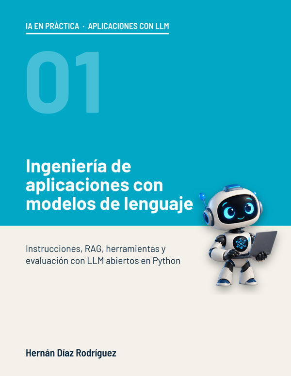

<!-- Encabezado en HTML: GitHub Pages no interpreta Markdown dentro de un <div>, y así se ve igual en los dos sitios. -->
<div align="center">
  <h1>Ingeniería de aplicaciones con modelos de lenguaje</h1>
  <h3><em>Instrucciones, RAG, herramientas y evaluación con LLM abiertos en Python</em></h3>
  <p></p>
  <p>por <strong>Hernán Díaz Rodríguez, PhD</strong> · Profesor en la Universidad de Oviedo</p>
  <p>
    <a href="https://creativecommons.org/licenses/by-nc/4.0/deed.es"></a>
    
    
  </p>
</div>

---

## El libro

**Ingeniería de aplicaciones con modelos de lenguaje** enseña a construir aplicaciones fiables con un modelo de lenguaje ya entrenado. A lo largo de doce capítulos se construye, pieza a pieza, el asistente de atención al cliente de **Ciclos Norte**, una tienda de bicicletas de Oviedo: instrucciones que funcionan, ejemplos y razonamiento, salidas estructuradas, búsqueda semántica, RAG, gestión del contexto y del coste, llamadas a funciones, ajuste fino con LoRA, evaluación y barreras de seguridad. El último capítulo junta todas las piezas en una aplicación con interfaz web.

Todo funciona con **modelos abiertos y gratuitos**, sin claves de API ni servicios de pago: Qwen2.5-1.5B-Instruct en la GPU gratuita de Colab y, sin GPU, Qwen3-0.6B en el procesador. Cada cifra del libro sale de un experimento que puedes repetir en el cuaderno del capítulo.

Forma parte de la colección **IA en práctica**: libros prácticos de inteligencia artificial con experimentos propios, un cuaderno y un vídeo en cada capítulo.

> *Prefer English?* The English edition, **Building Applications with Language Models**, with its own store, data and experiments, is in the [`en/`](./en) folder.

---

## Capítulos

| Cap. | Título | Cuaderno | Vídeo |
|------|--------|----------|-------|
| 1 | Instrucciones que funcionan | [](https://colab.research.google.com/github/HernanDiaz/llm-engineering/blob/main/cuadernos/1_Instrucciones_que_funcionan.ipynb) | próximamente |
| 2 | Ejemplos y razonamiento paso a paso | [](https://colab.research.google.com/github/HernanDiaz/llm-engineering/blob/main/cuadernos/2_Ejemplos_y_razonamiento.ipynb) | próximamente |
| 3 | Salidas estructuradas | [](https://colab.research.google.com/github/HernanDiaz/llm-engineering/blob/main/cuadernos/3_Salidas_estructuradas.ipynb) | próximamente |
| 4 | Embeddings y búsqueda semántica | [](https://colab.research.google.com/github/HernanDiaz/llm-engineering/blob/main/cuadernos/4_Embeddings_y_busqueda.ipynb) | próximamente |
| 5 | Generación aumentada con recuperación (RAG) | [](https://colab.research.google.com/github/HernanDiaz/llm-engineering/blob/main/cuadernos/5_RAG.ipynb) | próximamente |
| 6 | RAG avanzado | [](https://colab.research.google.com/github/HernanDiaz/llm-engineering/blob/main/cuadernos/6_RAG_avanzado.ipynb) | próximamente |
| 7 | Gestionar el contexto y el coste | [](https://colab.research.google.com/github/HernanDiaz/llm-engineering/blob/main/cuadernos/7_Contexto_y_coste.ipynb) | próximamente |
| 8 | Llamadas a funciones | [](https://colab.research.google.com/github/HernanDiaz/llm-engineering/blob/main/cuadernos/8_Llamadas_a_funciones.ipynb) | próximamente |
| 9 | Ajuste fino con LoRA | [](https://colab.research.google.com/github/HernanDiaz/llm-engineering/blob/main/cuadernos/9_Ajuste_fino_LoRA.ipynb) | próximamente |
| 10 | Evaluar una aplicación con LLM | [](https://colab.research.google.com/github/HernanDiaz/llm-engineering/blob/main/cuadernos/10_Evaluacion.ipynb) | próximamente |
| 11 | Barreras de seguridad | [](https://colab.research.google.com/github/HernanDiaz/llm-engineering/blob/main/cuadernos/11_Barreras_de_seguridad.ipynb) | próximamente |
| 12 | Proyecto: el asistente de Ciclos Norte | [](https://colab.research.google.com/github/HernanDiaz/llm-engineering/blob/main/cuadernos/12_Asistente_completo.ipynb) | próximamente |

---

## Cómo usar los cuadernos

- Pulsa **Abrir en Colab** y ejecuta las celdas en orden. No hace falta instalar nada.
- Activa la GPU gratuita: *Entorno de ejecución → Cambiar tipo de entorno de ejecución → GPU T4*. Sin GPU, los cuadernos eligen solos un modelo más pequeño que funciona en el procesador, más despacio.
- Los cuadernos descargan solos los datos de la carpeta `datos/` la primera vez.
- El cuaderno 4 no usa ningún modelo de lenguaje y funciona bien sin GPU. El 10 es el más largo: carga cinco modelos y hace unas 800 llamadas.

---

## Estructura del repositorio

```
llm-engineering/
├── cuadernos/          ← Un cuaderno por capítulo
├── datos/              ← La tienda: preguntas frecuentes, condiciones, catálogo, pedidos, pruebas…
├── latex/tema_10/      ← Las etiquetas manuales que usa el cuaderno 10
├── cuaderno/N/         ← Los enlaces del libro a cada cuaderno en Colab
├── video/N/            ← Los enlaces del libro al vídeo de cada capítulo
└── en/                 ← Edición en inglés: cuadernos, datos y enlaces
```

---

## Datos

Ciclos Norte y todos sus datos son inventados.

| Archivo | Contenido | Capítulos |
|---------|-----------|-----------|
| `correos_clasificados.json` | 50 correos de clientes con su categoría | 2 |
| `correos_extraccion.json` | 24 correos con los datos que hay que extraer | 3 |
| `preguntas_frecuentes.json` | 30 preguntas frecuentes y 30 consultas escritas con otras palabras | 4 a 12 |
| `condiciones_generales.md` | Las condiciones generales de venta, en doce secciones | 4 a 12 |
| `catalogo.json` | 40 productos con referencia, precio y descripción | 6, 10 y 12 |
| `consultas_recuperacion.json` | 40 consultas para medir la búsqueda | 6 |
| `pedidos.json` y `existencias.json` | Los pedidos y el almacén que consultan las herramientas | 8 y 12 |
| `banco_evaluacion.json` | 50 preguntas con su respuesta de referencia y sus claves | 10 |
| `prueba_final.json` | Los 86 casos de la prueba final | 12 |

---

## El autor

**Hernán Díaz Rodríguez** es profesor del Departamento de Ciencias de la Computación e Inteligencia Artificial de la **Universidad de Oviedo**, donde se doctoró en Informática. Trabajó cinco años como ingeniero de software en el **CERN**.

[LinkedIn](https://www.linkedin.com/in/hernandiazrodriguez) · [Correo](mailto:hernan.diaz.rodriguez@gmail.com) · [Página de autor en Amazon](https://www.amazon.es/Hernan-Diaz-Rodriguez/e/B0GD8JQ9JB)

---

## Licencia

Este material se distribuye bajo la licencia [Creative Commons Reconocimiento-NoComercial 4.0 Internacional (CC BY-NC 4.0)](https://creativecommons.org/licenses/by-nc/4.0/deed.es): se puede usar y adaptar para docencia y estudio citando al autor, pero no con fines comerciales.

Los modelos que usan los cuadernos tienen sus propias licencias: Qwen2.5 y Qwen3 (Apache 2.0), multilingual-e5-base (MIT) y bge-reranker-v2-m3 (Apache 2.0).

## Cómo citar

```bibtex
@book{diazrodriguez2026aplicaciones,
  author    = {Hern{\'a}n D{\'\i}az Rodr{\'\i}guez},
  title     = {Ingenier{\'\i}a de aplicaciones con modelos de lenguaje: Instrucciones, RAG, herramientas y evaluaci{\'o}n con LLM abiertos en Python},
  year      = {2026},
  publisher = {Publicaci{\'o}n independiente},
  url       = {https://github.com/HernanDiaz/llm-engineering}
}
```
