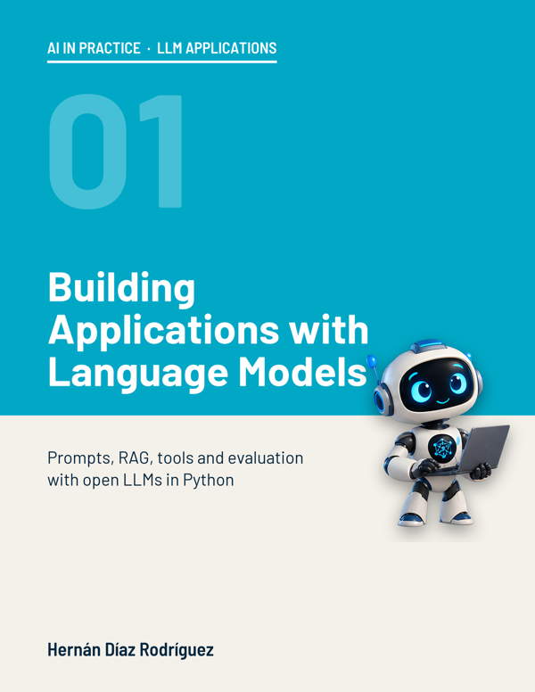

  <h1>Building Applications with Language Models</h1>
  <h3><em>Prompts, RAG, tools and evaluation with open LLMs in Python</em></h3>
  

  
by <strong>Hernán Díaz Rodríguez, PhD</strong> · Professor at the University of Oviedo

  

    
    
    
  

  

    
    
  

---

## The book

**Building Applications with Language Models** teaches how to build reliable applications on top of an already trained language model. Over twelve chapters, it builds, piece by piece, the customer service assistant of **North Cycles**, a bicycle store in Portland, Oregon: prompts that work, examples and reasoning, structured outputs, semantic search, RAG, context and cost management, function calling, LoRA fine-tuning, evaluation and guardrails. The last chapter puts all the pieces together into an application with a web interface.

Everything runs on **free, open models**, with no API keys or paid services: Qwen2.5-1.5B-Instruct on Colab's free GPU and, without a GPU, Qwen3-0.6B on the processor. Every figure in the book comes from an experiment you can repeat in the chapter's notebook. This edition is not a plain translation: the store, its data and every experiment are its own, run in English.

It belongs to the **AI in Practice** series: hands-on books on artificial intelligence, with original experiments, a notebook and a video in every chapter.

> *¿Prefieres español?* La edición española, **Ingeniería de aplicaciones con modelos de lenguaje**, está en la [raíz del repositorio](../).

---

## Chapters

Each chapter has its notebook on Google Colab and its video, with Robotín and the author. All the videos are in the [YouTube playlist](https://www.youtube.com/playlist?list=PLVNs0ZclLRpU).

| Ch. | Title | Notebook | Video |
|-----|-------|----------|-------|
| 1 | Prompts that work |  |  |
| 2 | Examples and step-by-step reasoning |  |  |
| 3 | Structured outputs |  |  |
| 4 | Embeddings and semantic search |  |  |
| 5 | Retrieval-augmented generation (RAG) |  |  |
| 6 | Advanced RAG |  |  |
| 7 | Managing context and cost |  |  |
| 8 | Function calling |  |  |
| 9 | Fine-tuning with LoRA |  |  |
| 10 | Evaluating an LLM application |  |  |
| 11 | Guardrails |  |  |
| 12 | Project: the North Cycles assistant |  |  |

---

## How to use the notebooks

- Click **Open in Colab** and run the cells in order. Nothing needs to be installed.
- Turn on the free GPU: *Runtime → Change runtime type → T4 GPU*. Without a GPU, the notebooks choose a smaller model that runs on the processor, more slowly.
- The notebooks download the files of the `data/` folder by themselves the first time.

## Data

North Cycles and all its data are fictional: e-mails, FAQ, terms and conditions, catalog, orders, stock and the test sets of each chapter, in [`data/`](./data). The manual labels used in chapter 10 are in [`chapter_10/`](./chapter_10).

---

## License

This material is distributed under the [Creative Commons Attribution-NonCommercial 4.0 International (CC BY-NC 4.0)](https://creativecommons.org/licenses/by-nc/4.0/) license: it can be used and adapted for teaching and study, crediting the author, but not for commercial purposes. The models used by the notebooks have their own licenses: Qwen2.5 and Qwen3 (Apache 2.0), multilingual-e5-base (MIT) and bge-reranker-v2-m3 (Apache 2.0).
